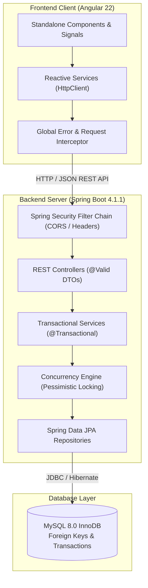

<<<<<<< HEAD
# StockSmart — Multi-Facility Retail Inventory Management System

[]()
[]()
[]()
[]()
[]()
[]()

> **StockSmart** is an enterprise-grade retail inventory and supply chain management platform designed for multi-facility operations. Built with modern Spring Boot and Angular, it guarantees strict ACID transactional consistency, pessimistic concurrency locking, complete audit ledgers, and real-time operational visibility across central warehouses, fulfillment centers, and retail stores.

---

## Table of Contents

- [1. Business Problem & Solution](#1-business-problem--solution)
- [2. System Architecture](#2-system-architecture)
- [3. Key Business Modules](#3-key-business-modules)
- [4. Technology Stack](#4-technology-stack)
- [5. Repository Structure](#5-repository-structure)
- [6. Prerequisites](#6-prerequisites)
- [7. Quick Start & Local Setup](#7-quick-start--local-setup)
  - [Step 1: Database Setup](#step-1-database-setup)
  - [Step 2: Backend Configuration](#step-2-backend-configuration)
  - [Step 3: Run the Backend](#step-3-run-the-backend)
  - [Step 4: Run the Frontend](#step-4-run-the-frontend)
- [8. Configuration & Environment Variables](#8-configuration--environment-variables)
- [9. REST API Summary](#9-rest-api-summary)
- [10. Testing & Quality Assurance](#10-testing--quality-assurance)
- [11. Technical Documentation](#11-technical-documentation)

---

## 1. Business Problem & Solution

Retailers with multi-node distribution networks frequently suffer from:
* **Inventory Opacity**: Inability to see real-time available vs. reserved stock across facilities.
* **Concurrency Conflicts**: Race conditions when multiple facilities allocate or transfer identical stock simultaneously.
* **Audit Breakdowns**: Stock adjustments or inbound receipts lacking verifiable ledger trails.

**StockSmart solves this** by providing:
1. **Pessimistic Row-Level Locking (`PESSIMISTIC_WRITE`)**: Eliminates race conditions and deadlocks during inter-facility stock transfers.
2. **Atomic Inventory Allocations**: Instant balance calculations separating **On-Hand** from **Reserved** stock.
3. **Immutable Audit Ledger**: Every inbound shipment (`RECEIPT`), outbound order (`SALE`), adjustment (`ADJUSTMENT`), and transfer (`TRANSFER_OUT` / `TRANSFER_IN`) records an append-only transaction.
4. **Real-Time Reactive UI**: Modern Angular 22 Single Page Application utilizing native signals and clean enterprise design tokens.

---

## 2. System Architecture



---

## 3. Key Business Modules

| Module | Core Functionality |
| :--- | :--- |
| **Executive Dashboard** | Live computation of total stock valuation, active SKUs, total on-hand units, low-stock warnings, and recent transaction feeds. |
| **Product Catalog** | SKU master registry, category classification, barcodes, reorder threshold triggers, and unit cost/selling prices. |
| **Category Management** | Hierarchy and grouping for catalog organization. Automatically seeded with default categories on startup. |
| **Multi-Facility Inventory** | Location-specific inventory balances with atomic adjustments (+/-) and on-hand vs. reserved tracking. |
| **Facility Directory** | Multi-facility tracking across Warehouses (`WAREHOUSE`), Fulfillment Hubs (`FULFILLMENT_CENTER`), and Retail Stores (`RETAIL_STORE`). |
| **Stock Transfers** | Inter-facility transfer workflows with row-level locks, deadlock prevention, and dual audit ledger generation. |
| **Purchase Receiving** | Inbound supplier shipment intake with multi-item entry, automatic balance increment, and immutable `RECEIPT` records. |
| **Customer Orders** | Order intake and one-click fulfillment with automated stock deductions and status tracking (`PENDING` -> `FULFILLED`). |
| **Supplier Directory** | Vendor master registry tracking procurement relationships, contact information, and supplier lines. |
| **Reports & Analytics** | 7 dedicated live report categories (Overview, Stock Status, Movements, Facility Breakdown, Transfers, Receiving, Fulfillment) with RFC 4180 CSV export. |

---

## 4. Technology Stack

### Backend
- **Language**: Java 21 LTS
- **Framework**: Spring Boot 4.1.1
- **Persistence**: Spring Data JPA / Hibernate ORM
- **Database**: MySQL 8.0 (InnoDB engine with strict foreign keys)
- **Security**: Spring Security (Permit-all API access with CORS origin whitelisting, `X-Frame-Options: DENY`, `X-Content-Type-Options: nosniff`)
- **Build Tool**: Apache Maven (via included `mvnw` wrapper)

### Frontend
- **Framework**: Angular 22
- **Language**: TypeScript 5.x
- **Architecture**: Standalone Components, Reactive Signals (`signal`, `computed`), Reactive Forms
- **Styling**: Tailored Enterprise SaaS Design System (Dark navy `#0f172a`, Slate `#f8fafc`, INR ₹ / USD $ currency support)

---

## 5. Repository Structure

```
StockSmart-HCL-Project/
├── .gitignore                     # Root repository ignore rules
├── README.md                      # Master repository documentation (this file)
│
├── stocksmart/                    # Backend Spring Boot Application
│   ├── .env                       # Local secrets (ignored by Git)
│   ├── .env.example               # Backend environment variables template
│   ├── pom.xml                    # Maven project configuration
│   ├── mvnw / mvnw.cmd            # Maven wrapper scripts
│   ├── database/                  # SQL DDL & Demonstration Seed Scripts
│   │   ├── schema.sql             # Complete database schema definition
│   │   └── seed-data.sql          # Sample categories, locations, suppliers, stock
│   ├── docs/                      # Architectural & Technical Specifications
│   │   ├── API_DOCUMENTATION.md   # Complete REST API reference
│   │   ├── ArchitectureDocument.md# Architectural decisions & concurrency model
│   │   ├── DatabaseDesign.md      # ER diagrams and schema specifications
│   │   ├── DEPLOYMENT.md          # Production deployment guide
│   │   └── TESTING.md             # Test plan and coverage analysis
│   └── src/
│       ├── main/java/com/hcl/stocksmart/
│       │   ├── StocksmartApplication.java  # Application entrypoint with .env loader
│       │   ├── config/            # Security, CORS, and DataInitializer
│       │   ├── controller/        # REST API controllers
│       │   ├── dto/               # Strongly-typed request/response records
│       │   ├── entity/            # JPA entities (Product, Inventory, Order, etc.)
│       │   ├── exception/         # GlobalExceptionHandler and custom exceptions
│       │   ├── repository/        # Spring Data JPA repositories
│       │   └── services/          # Transactional business services
│       └── main/resources/
│           └── application.properties # Externalized configuration
│
└── frontend/                      # Frontend Angular 22 Application
    ├── .env.example               # Frontend environment template
    ├── package.json               # NPM package dependencies
    ├── angular.json               # Angular CLI configuration
    └── src/
        ├── app/
        │   ├── core/              # Models, API services, interceptors
        │   ├── features/          # Feature components (dashboard, products, etc.)
        │   ├── layout/            # Navbar, sidebar, app-shell
        │   └── shared/            # Reusable UI components (badges, icons, modals)
        ├── environments/          # Environment endpoints
        └── styles.css             # Enterprise design system CSS
```

---

## 6. Prerequisites

Ensure you have the following installed locally:
* **Java Development Kit (JDK)**: Version 21 LTS (`java -version`)
* **Node.js**: Version 20.x or 22.x LTS (`node -v`)
* **NPM**: Version 10+ (`npm -v`)
* **MySQL Server**: Version 8.0+ running on port 3306 (`mysql --version`)

---

## 7. Quick Start & Local Setup

### Step 1: Database Setup
Start your local MySQL service, log in, and execute the schema script:
```powershell
# Create database schema
mysql -u root -p < stocksmart/database/schema.sql

# (Optional) Seed realistic demonstration data (Categories, Facilities, SKUs, Stock)
mysql -u root -p stocksmart < stocksmart/database/seed-data.sql
```

### Step 2: Backend Configuration
Inside the `stocksmart/` directory, create your `.env` file from the template:
```powershell
cd stocksmart
cp .env.example .env
```
Open `.env` and set your MySQL password:
```properties
DB_PASSWORD=your_actual_mysql_password
```

### Step 3: Run the Backend
From the `stocksmart/` directory, start the Spring Boot application using the Maven wrapper:
```powershell
# Set JAVA_HOME if not already configured in your system environment:
# $env:JAVA_HOME="C:\Program Files\Java\jdk-21.0.12.1"
# $env:Path="C:\Program Files\Java\jdk-21.0.12.1\bin;$env:Path"

.\mvnw.cmd spring-boot:run
```
* The backend REST API will boot up at: `http://localhost:8080/api`
* On startup, the `DataInitializer` automatically verifies and seeds default categories if the database is clean.

### Step 4: Run the Frontend
Open a new terminal window, navigate to the `frontend/` directory, and install dependencies:
```powershell
cd frontend
npm install
npx ng serve
```
* Open your browser at: `http://localhost:4200`
* The application will load and automatically connect to your live Spring Boot backend.

---

## 8. Configuration & Environment Variables

StockSmart uses externalized environment configuration to keep sensitive credentials out of version control.

### Backend (`stocksmart/.env`)
| Variable | Default (Local) | Purpose |
| :--- | :--- | :--- |
| `SERVER_PORT` | `8080` | HTTP port for the Spring Boot server |
| `DB_URL` | `jdbc:mysql://localhost:3306/stocksmart...` | MySQL JDBC connection string |
| `DB_USERNAME` | `root` | Database username |
| `DB_PASSWORD` | *(empty / prompt)* | Database password |
| `DDL_AUTO` | `update` *(dev)* / `validate` *(prod)* | Hibernate schema management strategy |
| `SHOW_SQL` | `false` | Log SQL queries to console |
| `CORS_ALLOWED_ORIGINS` | `http://localhost:4200` | Whitelisted frontend origins |

### Frontend (`frontend/src/environments/environment.ts`)
| Property | Value | Purpose |
| :--- | :--- | :--- |
| `production` | `false` | Production mode toggle |
| `apiUrl` | `http://localhost:8080/api` | Base URL for backend REST API |

---

## 9. REST API Summary

All endpoints return JSON responses with standard HTTP status codes (`200 OK`, `201 Created`, `204 No Content`, `400 Bad Request`, `404 Not Found`, `409 Conflict`).

| Method | Endpoint | Description |
| :--- | :--- | :--- |
| **GET** | `/api/dashboard/summary` | Real-time valuation, inventory totals, and alerts |
| **GET** / **POST** | `/api/products` | Retrieve products catalog / Register new product SKU |
| **GET** / **PUT** / **DELETE** | `/api/products/{id}` | Manage single product record |
| **GET** / **POST** | `/api/categories` | Retrieve all categories / Create category |
| **GET** / **POST** | `/api/locations` | Retrieve facilities / Register new facility |
| **GET** | `/api/inventory` | Multi-facility inventory matrix (on-hand, reserved) |
| **POST** | `/api/inventory/adjust` | Manual stock level adjustment (+/-) with audit remark |
| **GET** / **POST** | `/api/stock-transfers` | List transfers / Execute inter-facility stock relocation |
| **GET** / **POST** | `/api/purchase-receivings` | Inbound intake records / Process shipment intake |
| **GET** / **POST** | `/api/orders` | List customer orders / Create new order |
| **POST** | `/api/orders/{id}/fulfill` | Fulfill order and deduct reserved stock atomically |
| **GET** / **POST** | `/api/suppliers` | Retrieve suppliers / Register vendor |
| **GET** | `/api/reports/{type}` | Live operational reports (`overview`, `stock-status`, etc.) |
| **GET** | `/api/reports/{type}/export` | Export report data to RFC 4180 CSV |

> Consult [`stocksmart/docs/API_DOCUMENTATION.md`](stocksmart/docs/API_DOCUMENTATION.md) for full request/response payloads.

---

## 10. Testing & Quality Assurance

### Backend Automated Tests
The backend test suite covers bean validation, pessimistic concurrency locking, transactional rollback, and reporting computations:
```powershell
cd stocksmart
.\mvnw.cmd test
```
* **Coverage**: 55+ automated unit and integration tests.
* **Pass Rate**: 100% (0 errors, 0 failures).

### Frontend Production Build & Lint
Verify the Angular frontend compiles cleanly for production:
```powershell
cd frontend
npx ng build
```

---

## 11. Technical Documentation

Detailed architecture specifications and design documents are located in `stocksmart/docs/`:

* 🏛️ [System Architecture Document](stocksmart/docs/ArchitectureDocument.md) — Concurrency control, transaction boundaries, and component interaction.
* 🗄️ [Database Design & ER Diagram](stocksmart/docs/DatabaseDesign.md) — Relational schema, indices, foreign keys, and constraints.
* 🔌 [REST API Endpoint Documentation](stocksmart/docs/API_DOCUMENTATION.md) — Comprehensive endpoint schemas and curl examples.
* 🧪 [Testing & QA Strategy](stocksmart/docs/TESTING.md) — Test suites, edge cases, and concurrency testing.
* 🚀 [Production Deployment Guide](stocksmart/docs/DEPLOYMENT.md) — Production hardening, MySQL configuration, and reverse proxy setup.

---

## Contributors & Acknowledgements
Developed for **HCL Retail Enterprise Systems**. Built with Java 21, Spring Boot, and Angular 22.

=======
# StockSmart-HCL-Project
>>>>>>> cebf4a2dc7082e1a38e8e36c2dd37a19e51f7109
