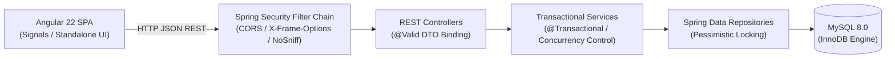

# StockSmart — Retail Inventory Management System

[]()
[]()
[]()
[]()
[]()
[]()

> **StockSmart** is an internal retail inventory management system delivering high-integrity stock tracking across multi-facility operations. Designed as a robust monolithic enterprise application, it ensures transactional consistency, auditability, and real-time operational visibility.

---

## Table of Contents
- [1. Problem Statement & Purpose](#1-problem-statement--purpose)
- [2. Key Features & Business Modules](#2-key-features--business-modules)
- [3. Technology Stack](#3-technology-stack)
- [4. High-Level Architecture](#4-high-level-architecture)
- [5. Prerequisites & Environment](#5-prerequisites--environment)
- [6. Local Setup & Quick Start](#6-local-setup--quick-start)
- [7. Configuration & Environment Variables](#7-configuration--environment-variables)
- [8. Running the Application](#8-running-the-application)
- [9. Testing & Quality Assurance](#9-testing--quality-assurance)
- [10. Technical Documentation Index](#10-technical-documentation-index)
- [11. Screenshots](#11-screenshots)

---

## 1. Problem Statement & Purpose
Modern retail and distribution businesses struggle with stock discrepancies, overselling, and inventory opacity across multiple warehouses and retail outlets. StockSmart provides a centralized operational hub where business operators can track on-hand and reserved stock balances in real time, record supplier intake shipments, execute inter-facility stock transfers with row-level concurrency protection, fulfill orders, and generate detailed audit trails without data loss.

---

## 2. Key Features & Business Modules

| Module | Core Capabilities |
| :--- | :--- |
| **Real Dashboard** | Real-time calculation of total valuation, active SKUs, on-hand units, low-stock warnings, and recent activity ledgers directly from backend data. |
| **Product Catalog** | Product catalog management with SKU uniqueness, category classification, supplier association, reorder thresholds, and pricing. |
| **Locations / Facilities** | Centralized directory of warehouses, distribution hubs, and retail outlets. |
| **Multi-Facility Inventory** | On-hand vs. reserved stock tracking, atomic adjustments (+/-), and automatic balance initialization. |
| **Inter-Facility Stock Transfers** | Atomic stock relocation between facilities with ordered row-level locking, deadlock prevention, and dual audit ledger generation. |
| **Purchase Receiving** | Inbound supplier shipment intake with immutable receipts, inventory increment, and `RECEIPT` audit tracking. |
| **Customer Orders** | Manual order capture and one-touch fulfillment with atomic stock deduction and immutable completed order protection. |
| **Suppliers** | Vendor directory with procurement tracking and product-line relationships. |
| **Reports & Analytics** | 7 dedicated live report categories (Overview, Stock Status, Movement Audit, Facility Breakdown, Transfers, Receiving, Order Fulfillment) and RFC 4180 CSV export. |

---

## 3. Technology Stack

### Backend
- **Language**: Java 21 LTS
- **Framework**: Spring Boot 4.1.1
- **Persistence**: Spring Data JPA / Hibernate ORM
- **Database Engine**: MySQL 8.0 (InnoDB)
- **Security & Headers**: Spring Security, CORS filter, X-Frame-Options (`DENY`), X-Content-Type-Options (`nosniff`)
- **Build Tool**: Apache Maven (`mvnw` wrapper)

### Frontend
- **Framework**: Angular 22
- **Language**: TypeScript 5.x
- **Architecture**: Standalone Components, Reactive Signals (`signal`, `computed`), Angular Router
- **Styling**: Enterprise SaaS Design System (Dark navy `#0f172a`, Slate borders `#cbd5e1`, Currency in INR ₹)

---

## 4. High-Level Architecture



---

## 5. Prerequisites & Environment
Ensure the following tools are installed on your machine:
- **Java**: JDK 21+ (`java -version`)
- **Node.js**: v20.x or v22.x LTS (`node -v`)
- **NPM**: v10+ (`npm -v`)
- **MySQL**: MySQL Server 8.0+ running on port 3306 (`mysql --version`)

---

## 6. Local Setup & Quick Start

### Step 1: Database Setup
Log into MySQL and initialize the database schema:
```bash
mysql -u root -p < database/schema.sql
```
*(Optional)* Load sample demonstration data:
```bash
mysql -u root -p stocksmart < database/seed-data.sql
```

### Step 2: Backend Configuration
Configure your database password via environment variables or verify `application.properties`:
```bash
cp application.properties.example src/main/resources/application.properties
```

---

## 7. Configuration & Environment Variables

StockSmart supports environment variables for production security. Fallbacks exist for local development:

| Variable | Default (Local) | Purpose |
| :--- | :--- | :--- |
| `SERVER_PORT` | `8080` | Spring Boot HTTP server port |
| `DB_URL` | `jdbc:mysql://localhost:3306/stocksmart` | MySQL JDBC database URL |
| `DB_USERNAME` | `root` | Database username |
| `DB_PASSWORD` | `SAKSKY2314` | Database password |
| `DDL_AUTO` | `validate` | Hibernate schema validation strategy |
| `SHOW_SQL` | `false` | Enable/disable SQL statement printing |
| `CORS_ALLOWED_ORIGINS` | `http://localhost:4200` | Comma-separated list of allowed origins |

---

## 8. Running the Application

### 8.1 Start the Spring Boot Backend
From the backend repository root (`d:\stocksmart`):
```powershell
$env:JAVA_HOME="C:\Program Files\Java\jdk-21.0.12.1"
$env:Path="C:\Program Files\Java\jdk-21.0.12.1\bin;$env:Path"

.\mvnw.cmd spring-boot:run
```
Backend API will be live at `http://localhost:8080/api`.

### 8.2 Start the Angular Frontend
From the frontend repository root (`d:\ss`):
```powershell
npm install
npx ng serve
```
Access the application in your browser at `http://localhost:4200`.

---

## 9. Testing & Quality Assurance

Run the automated test suite covering Bean Validation, HTTP error codes, concurrency, transaction rollback, and reporting logic:
```powershell
# Run all 55+ backend automated tests
.\mvnw.cmd test

# Build frontend production bundle
cd d:\ss
npx ng build

# Check dependencies for vulnerabilities
npm audit
```

All 55 backend tests pass with 0 failures and 0 errors.

---

## 10. Technical Documentation Index

For in-depth architectural and operational guides, consult the project documentation directory:

- [System Architecture Document](docs/ArchitectureDocument.md)
- [Database Design & ER Diagram](docs/DatabaseDesign.md)
- [REST API Endpoint Reference](docs/API_DOCUMENTATION.md)
- [Testing & Quality Assurance Guide](docs/TESTING.md)
- [Production Deployment Guide](docs/DEPLOYMENT.md)

---

## 11. Screenshots

| Section | Preview |
| :--- | :--- |
| **Real Dashboard** |  *(Live inventory KPIs, valuation, and recent movements)* |
| **Inventory & Facility Balances** |  *(Facility breakdown with on-hand and reserved stock)* |
| **Inter-Facility Stock Transfers** |  *(Atomic relocation modal with real-time stock checks)* |
| **Purchase Receiving Intake** |  *(Shipment receipt intake with multi-item entry)* |
| **Reports & Analytics** |  *(7 report types with live KPIs and CSV export)* |
