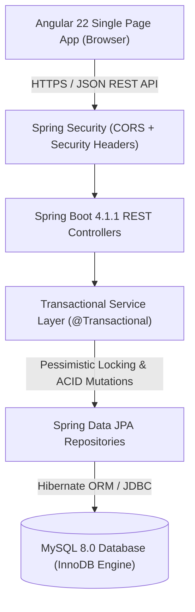
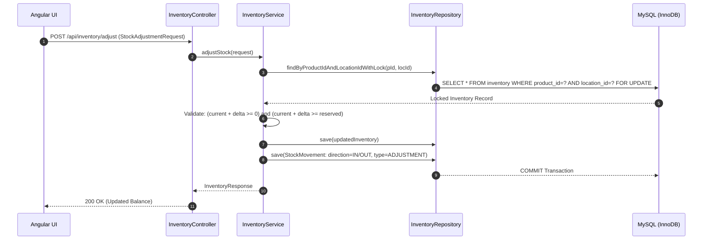
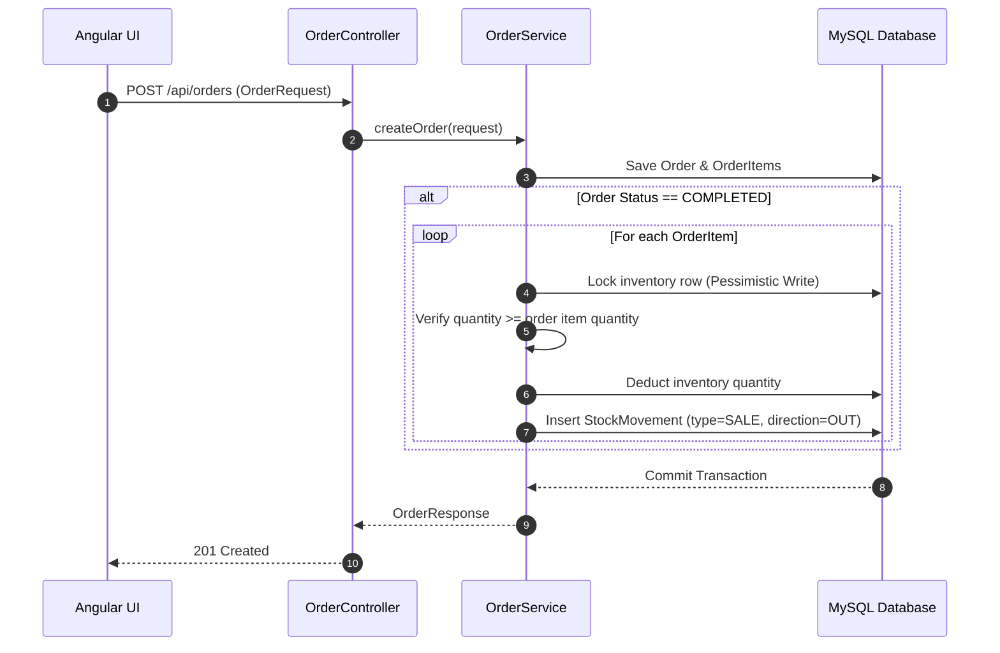
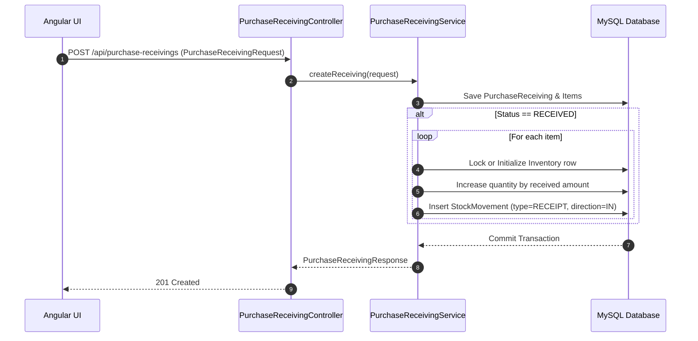
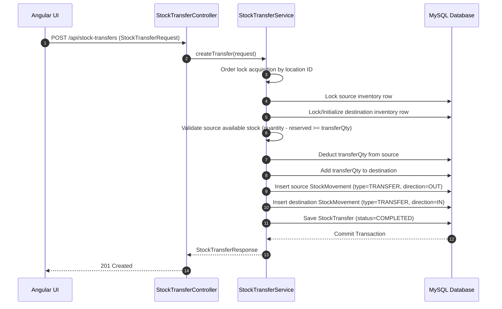

# StockSmart — System Architecture Document

## 1. System Overview

**StockSmart** is an internal retail inventory management system designed as a high-integrity, monolithic client-server application. It delivers deterministic inventory ledgering, inter-facility stock transfers, purchase receiving, customer order fulfillment, and operational analytics.



---

## 2. Architectural Layers & Responsibilities

### 2.1 Frontend Architecture (Angular 22)
- **Framework**: Angular 22 with Standalone Components and reactive Signals (`signal`, `computed`, `effect`).
- **State Management**: Local component signals coupled with injectable feature services. Signals drive reactivity without unnecessary zone churn or full component rebuilds.
- **Routing**: Angular Router with lazy-loaded route chunking for high performance.
- **UI & Layout**: Tailored enterprise design system utilizing a dark navy sidebar (`#0f172a`), slate borders (`#cbd5e1`), and clean light workspace surfaces.

### 2.2 Backend Architecture (Spring Boot 4.1.1 / Java 21)
- **Controller Layer (`com.hcl.stocksmart.controller`)**: Exposes RESTful HTTP endpoints, enforces input validation via `@Valid` annotations, and returns structured `ResponseEntity` payloads.
- **Service Layer (`com.hcl.stocksmart.services`)**: Encapsulates all business rules, concurrency locks, and transactional boundaries (`@Transactional`).
- **Repository Layer (`com.hcl.stocksmart.repository`)**: Spring Data JPA repositories with explicit queries and pessimistic write locking (`@Lock(LockModeType.PESSIMISTIC_WRITE)`).
- **Entity Domain Model (`com.hcl.stocksmart.entity`)**: JPA entity models mapping 1-to-1 with MySQL InnoDB tables with strict foreign key constraints.
- **Exception & Security Layer (`com.hcl.stocksmart.exception`, `config`)**: Unified `GlobalExceptionHandler` shielding internal database stack traces, configured CORS policies, and security headers (`X-Frame-Options: DENY`, `X-Content-Type-Options: nosniff`).

---

## 3. Core Business Transaction Flows

### 3.1 Inventory Mutation & Locking Strategy
All inventory changes must acquire a row-level pessimistic write lock on the corresponding `inventory` row (`SELECT ... FOR UPDATE`). When multiple inventory rows are involved (e.g., transfers), locks are acquired in a consistent ordering (by `product_id` and `location_id`) to eliminate deadlock hazards.



---

### 3.2 Customer Order Fulfillment Flow
Orders can be recorded in `PENDING` or `COMPLETED` state. When completed, stock is atomically deducted from the assigned facility and a `SALE` movement with `direction = 'OUT'` is registered. Completed orders are immutable.



---

### 3.3 Purchase Receiving Intake Flow
Receiving records log inbound stock shipments from approved suppliers. Upon confirmation (`status = RECEIVED`), stock is increased at the destination facility and a `RECEIPT` movement with `direction = 'IN'` is committed.



---

### 3.4 Inter-Facility Stock Transfer Flow
Transfers move stock atomically between two facilities. Source inventory is deducted, destination inventory is increased (or initialized), and two linked `StockMovement` records (`OUT` for source, `IN` for destination) are generated.



---

### 3.5 Reporting & Analytics Pipeline
All seven report endpoints in [`ReportService.java`](file:///D:/stocksmart/src/main/java/com/hcl/stocksmart/services/ReportService.java) compute live, non-cached metrics directly from transaction and inventory tables without side effects or mutations.

```mermaid
flowchart LR
    ReportsUI["Reports Angular Component"]
    ReportCtrl["ReportController (/api/reports/...)"]
    ReportSvc["ReportService"]
    DB[("MySQL Database")]

    ReportsUI -->|Filter Params (Dates, Facility, Status)| ReportCtrl
    ReportCtrl --> ReportSvc
    ReportSvc -->|Read-only Queries| DB
    DB -->|Raw Entities & Movements| ReportSvc
    ReportSvc -->|Compute KPIs, Grouping, Net Flow| ReportCtrl
    ReportCtrl -->|JSON DTO| ReportsUI
```
