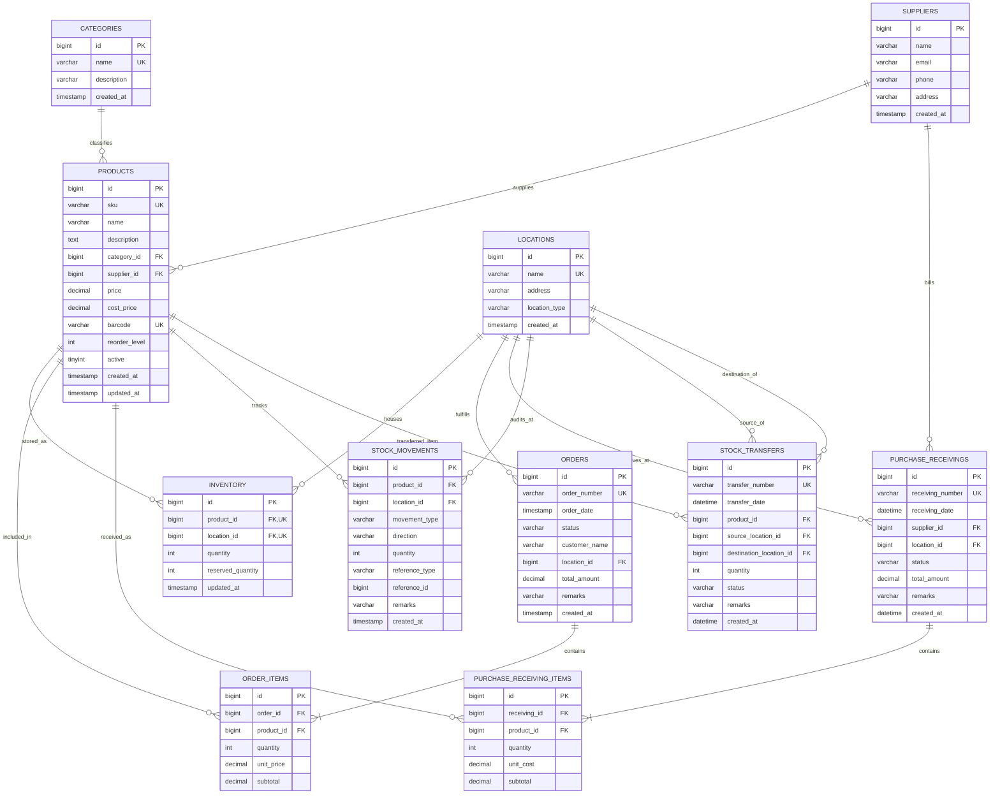

# StockSmart — Database Design Document

## 1. Overview
The StockSmart persistence tier is built on **MySQL 8.0** using the **InnoDB storage engine**. The relational schema is fully normalized and enforces referential integrity through strict foreign key constraints, unique indices, and check constraints.

---

## 2. Entity-Relationship Diagram

---

## 3. Table Specifications & Indexes

### 3.1 `categories`
| Column | Type | Constraints | Description |
| :--- | :--- | :--- | :--- |
| `id` | BIGINT | PRIMARY KEY, AUTO_INCREMENT | Category unique identifier |
| `name` | VARCHAR(100) | NOT NULL, UNIQUE | Human-readable category title |
| `description` | VARCHAR(255) | NULL | Scope or description of category |
| `created_at` | TIMESTAMP | DEFAULT CURRENT_TIMESTAMP | Record creation timestamp |

### 3.2 `locations`
| Column | Type | Constraints | Description |
| :--- | :--- | :--- | :--- |
| `id` | BIGINT | PRIMARY KEY, AUTO_INCREMENT | Facility unique identifier |
| `name` | VARCHAR(100) | NOT NULL, UNIQUE | Facility title (e.g. Warehouse, Store) |
| `address` | VARCHAR(255) | NULL | Physical address |
| `location_type` | VARCHAR(50) | NOT NULL | Type: `WAREHOUSE`, `RETAIL_STORE`, `FULFILLMENT_CENTER` |
| `created_at` | TIMESTAMP | DEFAULT CURRENT_TIMESTAMP | Record creation timestamp |

### 3.3 `suppliers`
| Column | Type | Constraints | Description |
| :--- | :--- | :--- | :--- |
| `id` | BIGINT | PRIMARY KEY, AUTO_INCREMENT | Supplier unique identifier |
| `name` | VARCHAR(150) | NOT NULL | Supplier business name |
| `email` | VARCHAR(150) | NULL | Primary contact email |
| `phone` | VARCHAR(20) | NULL | Primary telephone / mobile |
| `address` | VARCHAR(255) | NULL | Physical operational address |
| `created_at` | TIMESTAMP | DEFAULT CURRENT_TIMESTAMP | Record creation timestamp |

### 3.4 `products`
| Column | Type | Constraints | Description |
| :--- | :--- | :--- | :--- |
| `id` | BIGINT | PRIMARY KEY, AUTO_INCREMENT | Product unique identifier |
| `sku` | VARCHAR(100) | NOT NULL, UNIQUE | Stock keeping unit identifier |
| `name` | VARCHAR(150) | NOT NULL | Product marketing name |
| `description` | TEXT | NULL | Detailed specifications |
| `category_id` | BIGINT | NOT NULL, FK(`categories.id`) | Primary merchandise category |
| `supplier_id` | BIGINT | NULL, FK(`suppliers.id`) | Primary vendor / distributor |
| `price` | DECIMAL(10,2) | NOT NULL | Retail selling price (INR ₹) |
| `cost_price` | DECIMAL(10,2) | NULL | Acquisition cost price (INR ₹) |
| `barcode` | VARCHAR(100) | NULL, UNIQUE | EAN/UPC barcode number |
| `reorder_level` | INT | NOT NULL DEFAULT 0 | Low-stock threshold |
| `active` | TINYINT(1) | NOT NULL DEFAULT 1 | 1 = active, 0 = deactivated |
| `created_at` | TIMESTAMP | DEFAULT CURRENT_TIMESTAMP | Product addition timestamp |
| `updated_at` | TIMESTAMP | DEFAULT CURRENT_TIMESTAMP ON UPDATE | Last modification timestamp |

### 3.5 `inventory`
| Column | Type | Constraints | Description |
| :--- | :--- | :--- | :--- |
| `id` | BIGINT | PRIMARY KEY, AUTO_INCREMENT | Row identifier |
| `product_id` | BIGINT | NOT NULL, FK(`products.id`), UNIQUE(product_id, location_id) | Product reference |
| `location_id` | BIGINT | NOT NULL, FK(`locations.id`), UNIQUE(product_id, location_id) | Facility reference |
| `quantity` | INT | NOT NULL DEFAULT 0 | Total on-hand units |
| `reserved_quantity` | INT | NOT NULL DEFAULT 0 | Committed / allocated units |
| `updated_at` | TIMESTAMP | DEFAULT CURRENT_TIMESTAMP ON UPDATE | Last balance update timestamp |

> **Key Invariant**: Available Stock = `quantity` - `reserved_quantity`. System enforces `quantity >= reserved_quantity >= 0`.

### 3.6 `stock_movements` (Immutable Audit Log)
| Column | Type | Constraints | Description |
| :--- | :--- | :--- | :--- |
| `id` | BIGINT | PRIMARY KEY, AUTO_INCREMENT | Movement log identifier |
| `product_id` | BIGINT | NOT NULL, FK(`products.id`) | Product reference |
| `location_id` | BIGINT | NOT NULL, FK(`locations.id`) | Facility reference |
| `movement_type` | VARCHAR(30) | NOT NULL | Type: `RECEIPT`, `SALE`, `TRANSFER`, `ADJUSTMENT` |
| `direction` | VARCHAR(10) | NULL | Flow: `IN` (inflow) or `OUT` (outflow) |
| `quantity` | INT | NOT NULL | Magnitude of units changed (> 0) |
| `reference_type` | VARCHAR(50) | NULL | Business reference (e.g. Order #, Transfer #) |
| `reference_id` | BIGINT | NULL | Database ID of the triggering entity |
| `remarks` | VARCHAR(255) | NULL | Audit notes / operator explanation |
| `created_at` | TIMESTAMP | DEFAULT CURRENT_TIMESTAMP | Immutable creation timestamp |

### 3.7 `orders` and `order_items`
- `orders` stores header details (`order_number` UNIQUE, `customer_name`, `status`, `location_id`, `total_amount`).
- `order_items` stores line-level product snapshots (`product_id`, `quantity`, `unit_price`, `subtotal`).

### 3.8 `purchase_receivings` and `purchase_receiving_items`
- `purchase_receivings` stores shipment intake headers (`receiving_number` UNIQUE, `supplier_id`, `location_id`, `status`, `total_amount`).
- `purchase_receiving_items` stores received line items (`product_id`, `quantity`, `unit_cost`, `subtotal`).

### 3.9 `stock_transfers`
- `stock_transfers` stores inter-facility transfer orders (`transfer_number` UNIQUE, `product_id`, `source_location_id`, `destination_location_id`, `quantity`, `status`, `remarks`).
- Check constraint: `CHECK (quantity > 0)`.
